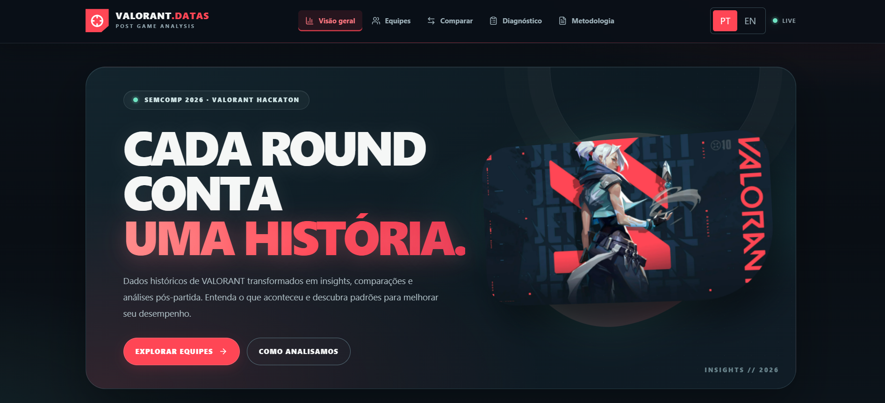
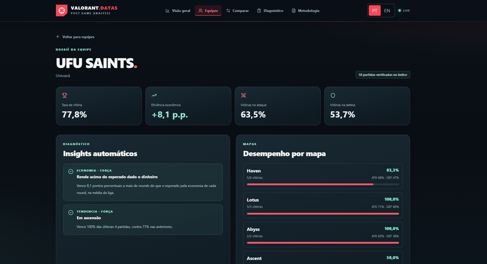
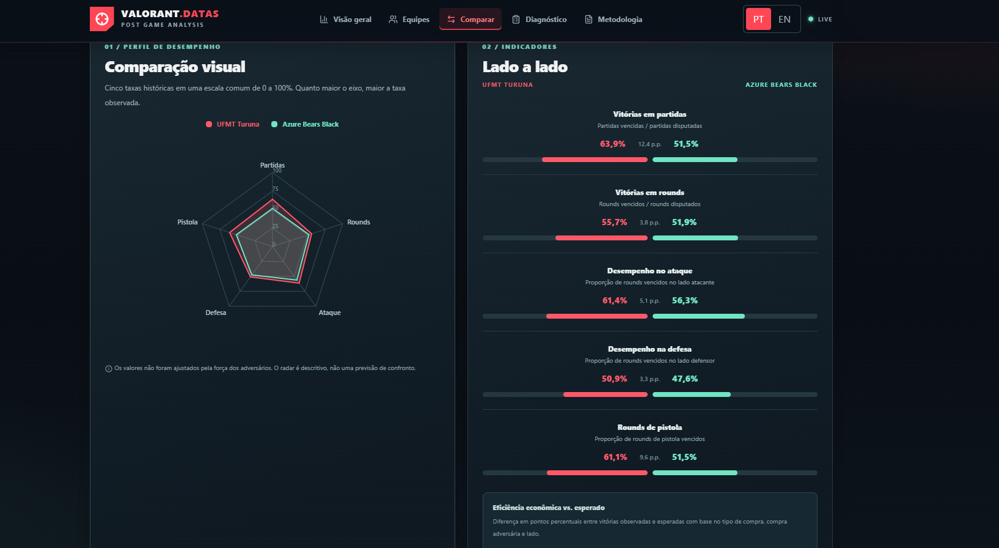

<div align="center">

# 🎯 VALORANT.DATAS

### Every round tells a story.

**A post-match analytics platform that turns historical VALORANT data into actionable insights, team comparisons, and performance diagnostics.**


**Developed for the SEMCOMP 2026 VALORANT Hackathon.**

</div>

---

## 📖 About the Project

**VALORANT.DATAS** is a bilingual (Portuguese and English) web application designed to help players, teams, and analysts better understand competitive VALORANT performance.

Instead of simply displaying match results, the platform organizes historical data into **interactive dashboards, team profiles, side-by-side comparisons, and evidence-based diagnostics**. Its goal is to support post-match review and highlight patterns worth investigating during practice.

The project uses **only the match JSON files supplied for the hackathon**. It does not collect live match data, use external match databases, or provide real-time competitive assistance.

---

## ✨ Features

- 📊 **League dashboard:** aggregated match statistics, rankings, map performance, and economy-related indicators.
- 👥 **Team directory:** search, filter by tournament participation, and sort teams by matches, win rate, or economy-adjusted performance.
- 🎯 **Detailed team profiles:** win rates, attack/defense performance, map history, player metrics, and recent matches.
- ⚔️ **Team comparison:** compare two teams through performance indicators, a radar chart, economy metrics, and shared maps.
- 🧠 **Team diagnostics:** identify statistical strengths and areas to improve, with supporting evidence and review suggestions.
- 💰 **Economy analysis:** examine buy classes and differences between observed and expected round results.
- 🗺️ **Map insights:** review historical attack/defense results and team win rates by map.
- 🌐 **Bilingual interface:** switch between Portuguese and English.
- 📱 **Responsive design:** desktop and mobile layouts with accessible navigation and loading/error states.

---

## 📊 Dataset Overview

The following figures describe the **processed hackathon dataset** used during development:

| Metric | Total |
|:--|--:|
| Match JSON files processed | **336** |
| Tournaments | **4** |
| Identified teams | **68** |
| Identified players | **411** |
| Actual rounds | **6,618** |
| Team-round records | **13,236** |
| Teams with profiles in the directory (5+ matches) | **47** |

> **Note:** Each actual round contributes one record per participating team, so the number of team-round records is twice the number of actual rounds. These counts describe the development dataset and may change if the processing pipeline is rerun with different authorized files.

---

## 🛠️ Technologies Used

### Frontend

- **Next.js (App Router)** — application routes, layouts, and server-side data loading.
- **React + TypeScript** — components, interactivity, and strongly typed data models.
- **Tailwind CSS** — responsive styling and reusable design patterns.
- **Recharts** — statistical charts and performance visualizations.
- **Lucide React** — icons and visual cues.

### Data Processing

- **Python** — transformation and aggregation of the supplied match files.
- **JSON and CSV** — source, intermediate, and application-ready data formats.

---

## ⚙️ How It Works

The application separates data processing from visualization:

1. **Input:** authorized historical match files in JSON format.
2. **Processing:** `processar2.py` extracts and structures information about matches, rounds, players, and eliminations into CSV files.
3. **Aggregation:** `agregar.py` generates league statistics, team summaries, detailed profiles, and rule-based insights.
4. **Publishing data:** the generated `liga.json`, `index.json`, and `times/*.json` files are placed in `public/dados/`.
5. **Visualization:** Next.js reads the local JSON files and presents the information through interactive pages.

```text
Authorized match JSONs
         │
         ▼
    processar2.py
         │
         ▼
   Structured CSVs
         │
         ▼
      agregar.py
         │
         ▼
 liga.json · index.json · times/*.json
         │
         ▼
     public/dados/
         │
         ▼
  VALORANT.DATAS (Next.js)
```

### Understanding Economy Delta

The platform compares a team's **observed round win rate** with an **expected win rate** calculated from historical groups based on its buy class, the opponent's buy class, and the side played.

**Economy delta (percentage points) = (observed win rate − expected win rate) × 100**

For example, if the expected win rate is 45% and the observed win rate is 52%, the economy delta is **+7.0 percentage points (p.p.)**.

A positive or negative delta is **not proof that economy caused the result**. It is a descriptive difference that helps identify situations for further review.

---

## 🚀 Getting Started

### Requirements

- **Node.js** and **npm**
- The project files and the **authorized, processed JSON dataset**
- **Python** only if you want to regenerate the processed data

### Installation

1. Clone your GitHub repository and open the project folder.
2. Install the dependencies:

   ```bash
   npm install
   ```

3. Confirm that the application data follows this structure:

   ```text
   public/
   └── dados/
       ├── index.json
       ├── liga.json
       └── times/
           ├── team-slug-1.json
           └── team-slug-2.json
   ```

   If necessary, copy the outputs from `dashboard_dados/` into `public/dados/`, keeping the `times/` subfolder intact.

4. Start the development server:

   ```bash
   npm run dev
   ```

5. Open **http://localhost:3000** in your browser.

### Production Build

```bash
npm run build
npm run start
```

> **Important:** The deployed application also needs the generated JSON files in `public/dados/`. Before publishing data in a public repository, confirm that redistribution is permitted by the hackathon rules.

---

## 📂 Project Structure

```text
valorant/
├── dados_brutos/           # Original match data (subject to sharing permissions)
├── dashboard_dados/        # Generated JSON files for the dashboard
│   ├── index.json
│   ├── liga.json
│   └── times/
├── saida/                  # Intermediate processing outputs
├── public/
│   └── dados/              # JSON data served by the application
├── src/
│   ├── app/                # Next.js pages, routes, and layouts
│   ├── components/         # Dashboard, comparison, and diagnostic UI
│   ├── lib/                # Data access, types, translations, and analytics
│   └── imgs/               # Visual assets
├── processar2.py           # Match-data processing
├── agregar.py              # Aggregation and insight generation
├── package.json
└── README.md
```

> The tree summarizes the main project areas and omits generated directories such as `node_modules/` and `.next/`.

---

## 🧠 Concepts and Skills Applied

- Data extraction, transformation, and aggregation
- Data visualization and dashboard design
- Descriptive statistical analysis and benchmarks
- Rule-based insights and evidence-based diagnostics
- React component architecture and state management
- Next.js App Router and server-side data access
- TypeScript interfaces and type safety
- Responsive UI design and accessibility
- Internationalization (Portuguese / English)
- Git and GitHub version control

---

## 🔎 Analysis Principles and Limitations

VALORANT.DATAS is built for **historical, post-match analysis**, not live coaching or match prediction.

- **Correlation is not causation:** differences in indicators do not establish why a team won or lost.
- **Sample size matters:** smaller samples can produce unstable percentages. Diagnostic rules apply minimum observation counts and difference thresholds.
- **Context matters:** opponents, maps, sides, team compositions, and economic conditions may vary.
- **Role classifications are estimates:** behavioral labels are analytical hypotheses, not verified player roles.
- **Economy categories are heuristics:** buy classes are derived from the available equipment information and are not exact spending records in every scenario.
- **No real-time advantage:** the platform uses only the historical dataset provided for the challenge.

These limitations are also explained in the application's **Methodology** section.

---

## 📸 Preview







A screenshot of the application dashboard can be added here once available.

---

## 👨‍💻 Development

📘 **Author:** [Vitor Henrique Morais](https://github.com/Vhcmorais)

🏆 **Project:** SEMCOMP 2026 — VALORANT Hackathon

---

## ⚖️ Disclaimer

VALORANT.DATAS is an **independent, educational hackathon project**. It is **not affiliated with, sponsored by, or endorsed by Riot Games**. VALORANT and related trademarks belong to their respective owners.

---

<div align="center">

✨ **Developed to transform historical competitive data into clearer, more responsible post-match analysis.**

</div>
